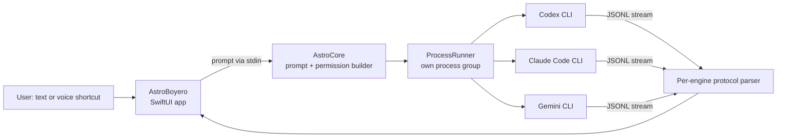

# Zemo

A native macOS companion (an astronaut Australian Shepherd living on your desktop) that opens a chat wired to **Codex, Claude Code or Gemini CLI**. One interface, three agent runtimes, and a permission model that is enforced in code and covered by tests rather than left to prompts.

Spanish documentation: [README.es.md](README.es.md) · Specs: [SPEC.md](SPEC.md), [SPEC-voz.md](SPEC-voz.md) · Test and audit log: [VALIDATION.md](VALIDATION.md)

## Why it exists

Agent CLIs inherit the user's whole shell, environment and filesystem. Zemo is an experiment in putting a safe, understandable client in front of them without hiding what the agent does: commands and their output stay visible, and the default is read-only.

## Architecture



- **AstroBoyero**: the macOS app (SwiftUI, sprites, menu-bar item, dictation).
- **AstroCore**: everything testable and security-relevant: argument and permission building per engine, JSONL parsing, environment filtering, process lifecycle, dictation policy. No UI dependencies.
- **AstroCoreChecks**: the test runner (`swift run --disable-sandbox AstroCoreChecks`).

## Design decisions

| Decision | Reason |
|---|---|
| Read-only is the default mode; editing requires confirmation and a specific project folder | The common case (ask, inspect) should be unable to change anything |
| Home-level hidden directories, `~/Library` and system paths are rejected as editable folders, children included | An audit showed a broad or sensitive folder could be picked for edit mode |
| Prompts are sent over stdin with literal, separate arguments, never through a shell | No injection through user text |
| Each engine receives only its own provider's environment variables | An audit showed the child process inherited unrelated API keys |
| Claude edit mode uses `default` permissions with `Edit`/`Write` explicitly allowed, not `acceptEdits` | Real test: `acceptEdits` also approved `rm` and deleted a file. A regression test now blocks going back |
| Stop terminates the whole process group (SIGTERM, then SIGKILL) with a 15-minute cap | Agents spawn children; cancelling must actually cancel |
| History sent to the model is limited to the last 12 messages; sessions are ephemeral | Bounded context and no hidden on-disk transcript |

## Engines

| | Codex | Claude | Gemini |
|---|---|---|---|
| Consult | `read-only` sandbox | `plan` mode, read-only commands only | `plan` mode, no terminal |
| Edit folder | `workspace-write` sandbox | Edit/Write allowed; `rm`, `mv` and others are refused | `auto_edit`, no terminal |

No engine runs with `--yolo`, `bypassPermissions` or full access.

## Build and test

Requires macOS 14+ and the engine CLIs you want to use, already logged in.

```bash
swift run --disable-sandbox AstroCoreChecks   # tests
bash scripts/build-app.sh                      # builds dist/Zemo.app
```

## Status and known limits

The core test suite passes and the audit findings are fixed with regression tests (see [VALIDATION.md](VALIDATION.md), which also lists what is **not** yet verified: voice accuracy on a real session, some UI flows, Notion/GitHub through Codex). Known open issues: output beyond 4,000 lines is dropped and could lose the final message; a child shell can leave the process group with `setsid`. The app is ad-hoc signed for local use; distribution would need Developer ID signing and notarization.

Original pixel art and code by the author.
